<div align="center">

# 🔐 Penetration Testing Report
### Footprinting & Network Scanning (Phase 1 and Phase 2)

**Target:** `networkwalks.com` &nbsp;|&nbsp; **Program:** Networkwalks Cybersecurity Program &nbsp;|&nbsp; **Date:** 9 November 2026


`#penetration-testing` `#ethical-hacking` `#footprinting` `#reconnaissance` `#network-scanning` `#nmap` `#kali-linux` `#cybersecurity` `#infosec` `#vulnerability-assessment` `#osint` `#dns-enumeration` `#tls-audit` `#red-team` `#pentest-report`

</div>

---

## 📑 Table of Contents

1. [Executive Summary](#-executive-summary)
2. [Report at a Glance](#-report-at-a-glance)
3. [Scope & Rules of Engagement](#-scope--rules-of-engagement)
4. [Methodology](#-methodology)
5. [Tools Used](#-tools-used)
6. [Phase 1: Footprinting & Reconnaissance](#-phase-1-footprinting--reconnaissance)
7. [Phase 2: Network Scanning with Nmap](#-phase-2-network-scanning-with-nmap)
8. [Findings Summary](#-findings-summary)
9. [Risk Analysis / Impact](#-risk-analysis--impact)
10. [Recommendations](#-recommendations)
11. [Limitations](#-limitations)
12. [Conclusion & Lessons Learned](#-conclusion--lessons-learned)
13. [Evidence Index](#-evidence-index)
14. [Repository Structure](#-repository-structure)
15. [Legal Disclaimer](#-legal-disclaimer)
16. [Author](#-author)

---

## 📌 Executive Summary

This report documents the **reconnaissance (Phase 1)** and **scanning (Phase 2)** stages of a penetration test against `networkwalks.com`, performed on **9 November 2026** with the owner's written permission as part of the Networkwalks Cybersecurity Program.

Six Kali Linux footprinting tools and a series of Nmap scans were used to move from public information gathering to a map of the target's open ports, service versions and TLS configuration.

**Headline results**

| Metric | Result |
| --- | --- |
| Open TCP ports found | **14** (21, 22, 26, 53, 80, 110, 143, 443, 465, 587, 993, 995, 2222, 3306) |
| Web stack | WordPress 7.1.4, WP Download Manager 3.3.76, Apache, jQuery 3.7.1 |
| WAF | ModSecurity (SpiderLabs) detected |
| DNSSEC | Not configured |
| Observations recorded | **11** (0 Critical, 5 Medium, 6 Low) |
| Exploitation performed | **None** (information gathering and service identification only) |

**Most important observations**
1. MySQL 5.7.44-48 (end-of-life) is reachable from the internet on port 3306.
2. FTP (21), POP3 (110) and IMAP (143) are open and may carry credentials unencrypted if TLS is not enforced.
3. The certificate on the IMAPS/POP3S ports (993/995) expired on 2025-12-21.
4. Web technology, versions and DNS details are publicly visible, and HTTP security headers (HSTS, CSP, X-Frame-Options) were not returned.
5. A second SSH service runs on port 2222.

> ⚠️ These are **observations, not confirmed vulnerabilities.** Confirming any of them requires further authorized testing.

---

## 🗂 Report at a Glance

| | |
| --- | --- |
| **Pentester** | Muhammad Anas Ishfaq (Cybersecurity Professional) |
| **Program / Batch** | Networkwalks Cybersecurity Program |
| **Date** | 9 November 2026 |
| **Modules completed** | Footprinting & Reconnaissance (multiple Kali tools), Network Scanning (Nmap) |
| **Targets** | 1. `networkwalks.com` (written permission secured) 2. Own local lab machine (Kali Linux, `10.0.0.2/24`) |
| **Permission secured?** | Yes |
| **Phases covered** | **Phase 1:** Reconnaissance & Footprinting, **Phase 2:** Scanning & Network Discovery, **Phase 3-5:** In progress |

---

## 🎯 Scope & Rules of Engagement

| Item | Detail |
| --- | --- |
| In scope | `networkwalks.com` and the hosts/services reachable through it |
| Attacker machine | Kali Linux, interface `eth0`, `10.0.0.2/24`, gateway `10.0.0.1` |
| Authorization | Written permission secured before testing |
| Allowed activity | Passive and active reconnaissance, port scanning, service and script enumeration |
| Not performed | Exploitation, brute-forcing, vulnerability validation, denial of service |
| Redaction | Target IP address, reverse DNS and hosting server name are blurred in screenshots |

---

## 🧭 Methodology

```text
┌────────────────────┐     ┌────────────────────┐     ┌────────────────────┐
│  PHASE 1           │ ──▶ │  PHASE 2           │ ──▶ │  PHASES 3-5        │
│  Reconnaissance &  │     │  Scanning &        │     │  In progress       │
│  Footprinting      │     │  Network Discovery │     │                    │
└────────────────────┘     └────────────────────┘     └────────────────────┘
 WHOIS · WhatWeb · Nslookup   Nmap port scan · -sV · -O
 Curl · Wafw00f · DNSRecon    NSE scripts (DNS/HTTP/SMTP/
                              MySQL/SSH/TLS)
```

Each step records the **command used**, the **result observed**, a **screenshot as evidence**, and **why the finding matters** from an attacker's point of view.

---

## 🛠 Tools Used

| Tool | Purpose |
| --- | --- |
| **Kali Linux** | Operating system used for all reconnaissance and scanning activities |
| **WHOIS** | Find domain registration details (registrar, dates, name servers) |
| **whatweb** | Fingerprint web technologies (server, CMS, plugins, libraries) |
| **nslookup** | Resolve the domain name to its IP address using DNS |
| **curl -I** | Read the HTTP response headers of the website |
| **wafw00f** | Detect whether a Web Application Firewall protects the site |
| **dnsrecon** | Enumerate DNS records (SOA, NS, MX, SPF/TXT, SRV) and DNSSEC status |
| **Nmap** (`-sS`, `-sV`, `-O`, `-Pn`, NSE scripts) | Discover open ports, identify service versions, guess the OS and run targeted scripts (DNS, HTTP, SMTP, MySQL, SSH, TLS) |
| **ip addr / ip route** | Identify the local IP address, subnet and default gateway |

---

## 🔎 Phase 1: Footprinting & Reconnaissance

Six Kali Linux tools were used against `networkwalks.com`: **WHOIS, WhatWeb, Nslookup, Curl, Wafw00f and DNSRecon**. Each collected a different type of information.

### 1.1 WHOIS: domain registration

```bash
whois networkwalks.com
```

The domain was registered on **6 November 2019** through **GoDaddy.com, LLC** and expires on **6 November 2027**. Registrant and technical contact details are hidden behind a privacy service (Domains By Proxy, LLC). The domain has client transfer, update, renew and delete locks, and **DNSSEC is unsigned**. Name servers: **NS6135.HOSTGATOR.COM** and **NS6136.HOSTGATOR.COM** (the registrar record also lists NS29.DOMAINCONTROL.COM and NS30.DOMAINCONTROL.COM).

**Why it matters:** Registration data, dates and name servers show who hosts the domain and which infrastructure to profile next.

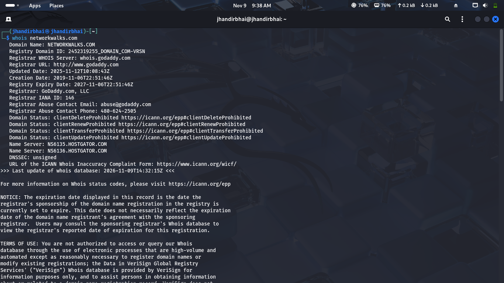
*Figure 1: WHOIS (registry record) for networkwalks.com*

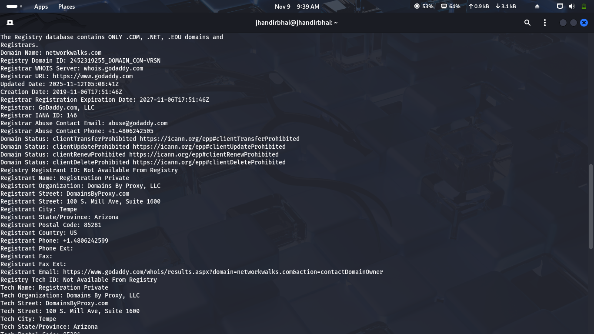
*Figure 2: WHOIS (registrar record), registrant and tech contact (privacy proxy)*

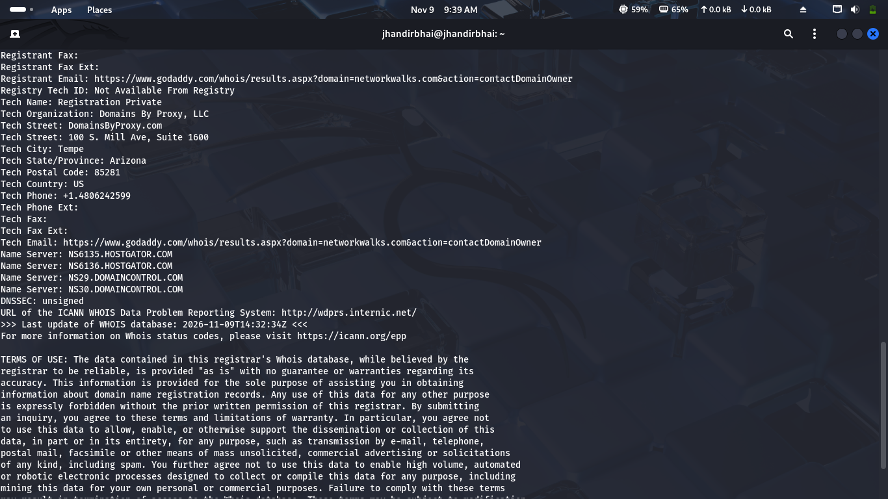
*Figure 3: WHOIS (registrar record), name servers and DNSSEC status*

### 1.2 WhatWeb: web technology fingerprinting

```bash
whatweb networkwalks.com
```

Identified **WordPress 7.1.4** and **WP Download Manager 3.3.76**, running on **Apache** with **jQuery 3.7.1**. Site title "Networkwalks Academy"; the contact email `info@networkwalks.com` was exposed; HTTP redirects to HTTPS with a 301.

**Why it matters:** Exposed CMS, plugin and library versions tell an attacker which software to research for known weaknesses.

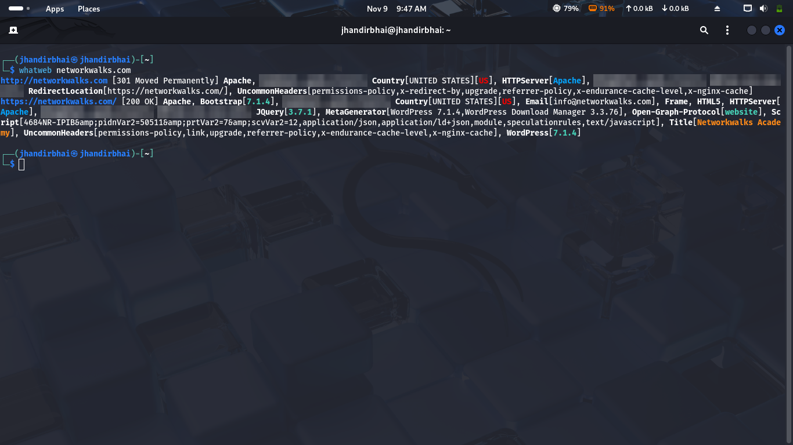
*Figure 4: WhatWeb fingerprint of networkwalks.com*

### 1.3 Nslookup: DNS resolution

```bash
nslookup networkwalks.com 8.8.8.8
```

Resolved the domain to its IP address via 8.8.8.8 (non-authoritative answer). The IP is redacted in the screenshot.

**Why it matters:** Reveals the network location of the web service.

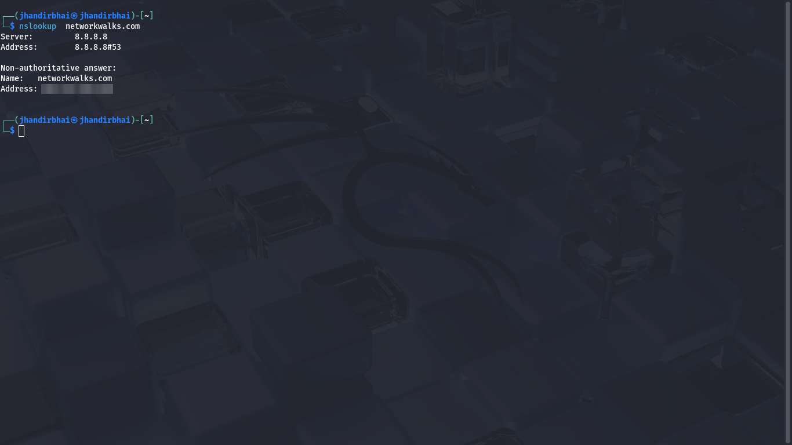
*Figure 5: Nslookup resolving networkwalks.com (IP redacted)*

### 1.4 Curl: HTTP response headers

```bash
curl -I https://networkwalks.com
```

Returned **HTTP/2 200** from **Apache**. The `Link` header exposed the WordPress REST API endpoint **`/wp-json/`**; cookies carried the Secure and HttpOnly flags; headers such as `x-nginx-cache` and `x-endurance-cache-level` revealed hosting details. **HSTS, Content-Security-Policy and X-Frame-Options were not present.**

**Why it matters:** Leaked hosting details aid fingerprinting, and missing security headers remove browser-side protections.

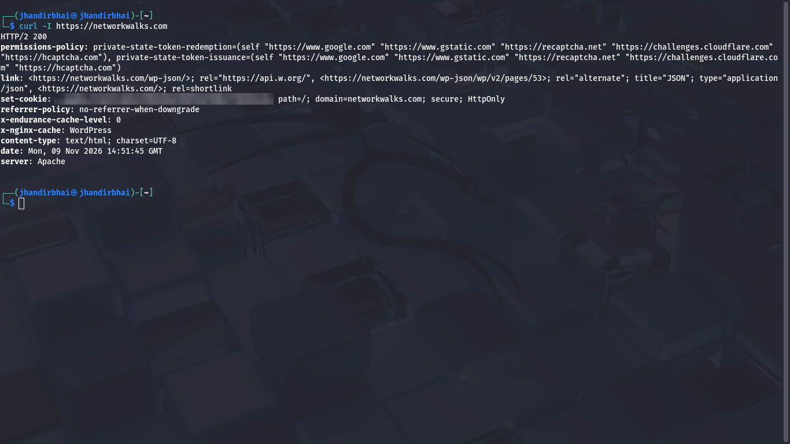
*Figure 6: Curl -I HTTP response headers*

### 1.5 Wafw00f: WAF detection

```bash
wafw00f https://networkwalks.com
```

Detected **ModSecurity (SpiderLabs)** after 2 requests.

**Why it matters:** Knowing the WAF in front of a site informs how an attacker would shape later requests.

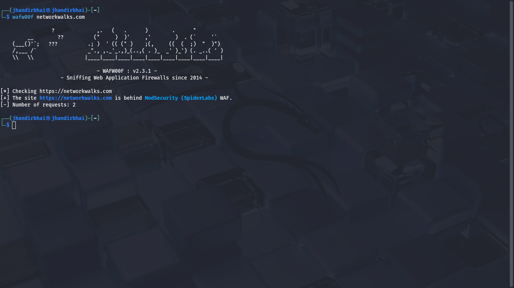
*Figure 7: Wafw00f result: ModSecurity (SpiderLabs)*

### 1.6 DNSRecon: DNS enumeration

```bash
dnsrecon -d networkwalks.com
```

Reported **DNSSEC is not configured**; listed SOA and NS records on the HostGator name servers (**BIND 9.16.23-RH**); found mail server **`mail.networkwalks.com`**; an SPF record (`v=spf1 +a +mx ... +include:websitewelcome.com ~all`); and **8 SRV records** for `_autodiscover._tcp` pointing to `cpanelemaildiscovery.cpanel.net:443`.

**Why it matters:** DNS records build a wider infrastructure profile, and no DNSSEC means answers are not cryptographically signed.

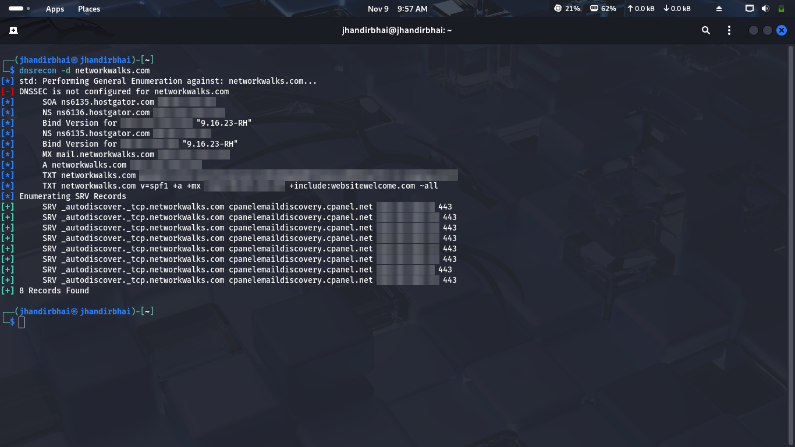
*Figure 8: DNSRecon enumeration of networkwalks.com*

---

## 📡 Phase 2: Network Scanning with Nmap

### 2.1 Local lab setup

```bash
ip -br addr
ip route
```

Lab machine: interface `eth0`, address **`10.0.0.2/24`**, default gateway **`10.0.0.1`**.

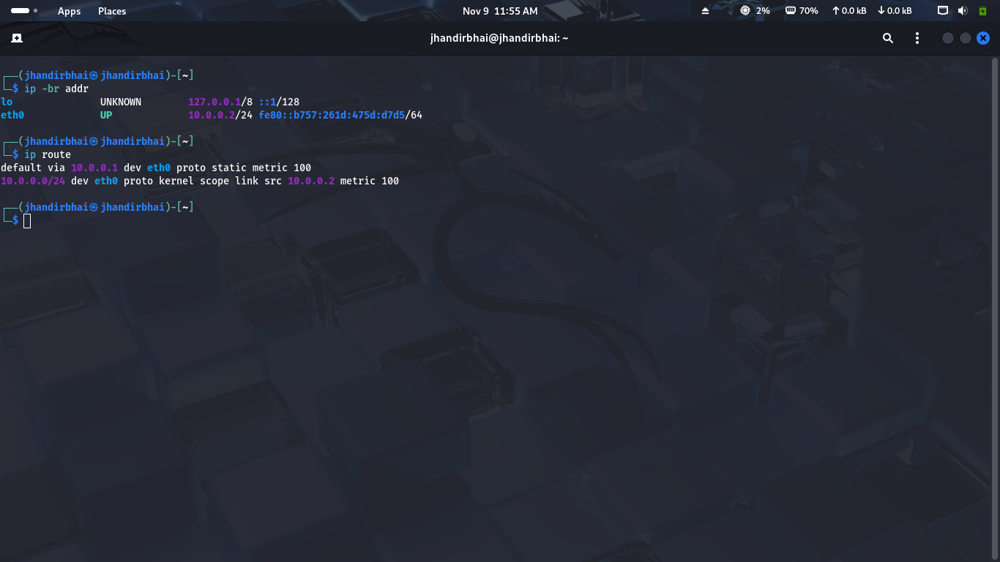
*Figure 9: Local IP address and route (ip -br addr, ip route)*

### 2.2 Basic port scan

```bash
nmap -T5 -Pn networkwalks.com
```

Host up (~0.26 s latency); 987 of 1000 ports filtered; **13 ports open** (465/tcp appeared in later scans).

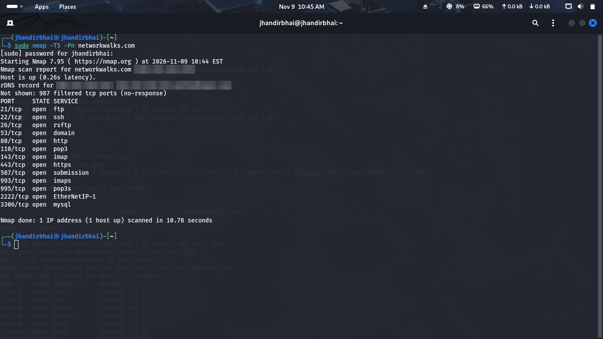
*Figure 10: Nmap -T5 -Pn scan: open ports*

**Consolidated open ports and services**

| Port | Service | Version / Notes |
| --- | --- | --- |
| 21/tcp | ftp | Pure-FTPd |
| 22/tcp | ssh | OpenSSH 9.9 (protocol 2.0) |
| 26/tcp | rsftp / smtp | Exim smtpd 4.100.1 |
| 53/tcp | domain | ISC BIND 9.16.23 (RedHat Linux), bind.version 9.16.23-RH |
| 80/tcp | http | Apache httpd; redirects to https://networkwalks.com/ |
| 110/tcp | pop3 | Dovecot pop3d |
| 143/tcp | imap | Dovecot imapd |
| 443/tcp | https | Apache httpd |
| 465/tcp | smtps | Exim smtpd 4.100.1 (not in the first scan; seen in later scans) |
| 587/tcp | submission | Exim smtpd 4.100.1 |
| 993/tcp | imaps | Dovecot imapd |
| 995/tcp | pop3s | Dovecot pop3d |
| 2222/tcp | EtherNetIP-1 (Nmap default label) | OpenSSH 9.9, a **second SSH service** |
| 3306/tcp | mysql | MySQL 5.7.44-48 |

### 2.3 Service version detection

```bash
sudo nmap -Pn -sS -sV --top-ports 1000 -T5 --reason networkwalks.com
```

| Flag | Meaning |
| --- | --- |
| `-sS` | TCP SYN (half-open) scan |
| `-sV` | Probe open ports to identify application and version |
| `-Pn` | Skip host discovery |
| `--reason` | Show why each port is open (here, `syn-ack`, TTL 64) |

Finished in **33.19 s**: 986 filtered, **14 open**. Confirmed OpenSSH 9.9 (22 and 2222), Exim 4.100.1, ISC BIND 9.16.23 and MySQL 5.7.44-48, and added Pure-FTPd (21), Dovecot (110/143/993/995) and Exim (465). Reported **OS: Linux**. Target IP, rDNS and hosting server name are blurred.

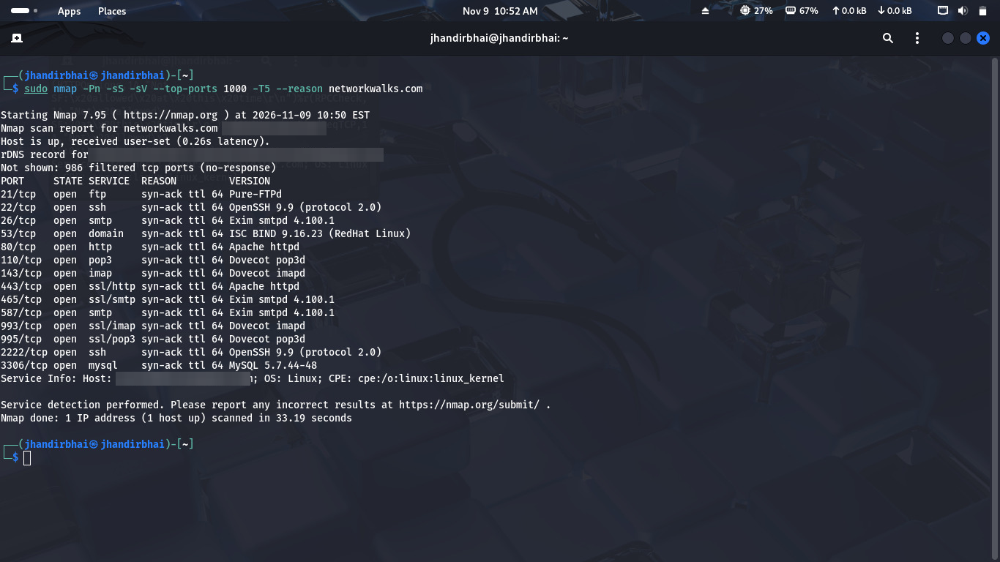
*Figure 24: Nmap -sS -sV service version detection (target IP and hostname blurred)*

### 2.4 OS detection

```bash
sudo nmap -T5 -Pn -O networkwalks.com
```

Nmap warned the result may be unreliable (no open and closed port pair) and returned no exact match. Guesses (Oracle VirtualBox, Slirp, QEMU) point to a virtualised or NAT-type path rather than the real server OS, so **this result is not reliable on its own**. The service scan (**Linux**) is the better indicator.

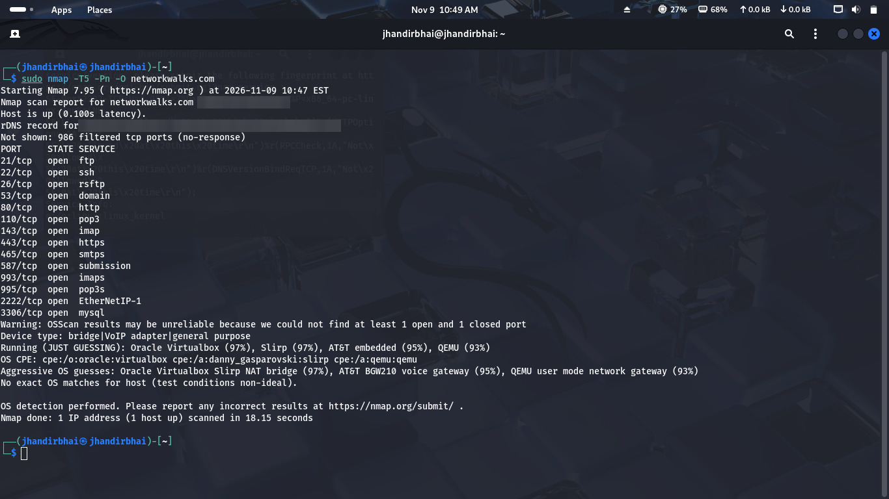
*Figure 25: Nmap -O operating system detection (target IP blurred)*

### 2.5 Targeted NSE scripts

#### DNS (53): `dns-nsid`
Returned `bind.version 9.16.23-RH`; service reported as ISC BIND on RedHat Linux.

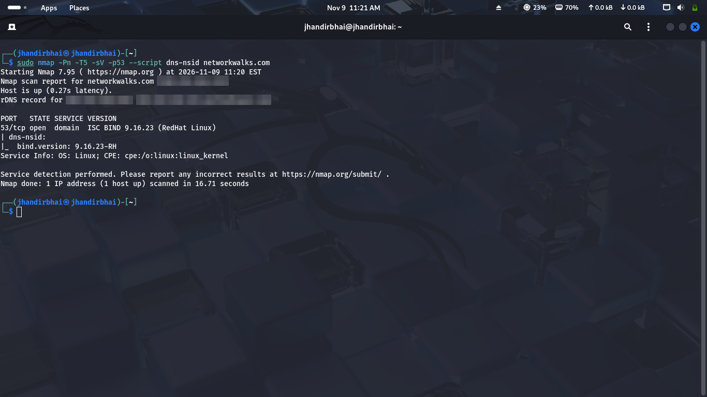
*Figure 11: Nmap dns-nsid scan on port 53*

#### HTTP/HTTPS (80, 443): `http-title`, `http-headers`
Port 80 redirects to HTTPS with `X-Redirect-By: WordPress - Really Simple Security`. Port 443 returned a redirect with `X-Robots-Tag: noindex, nofollow`.

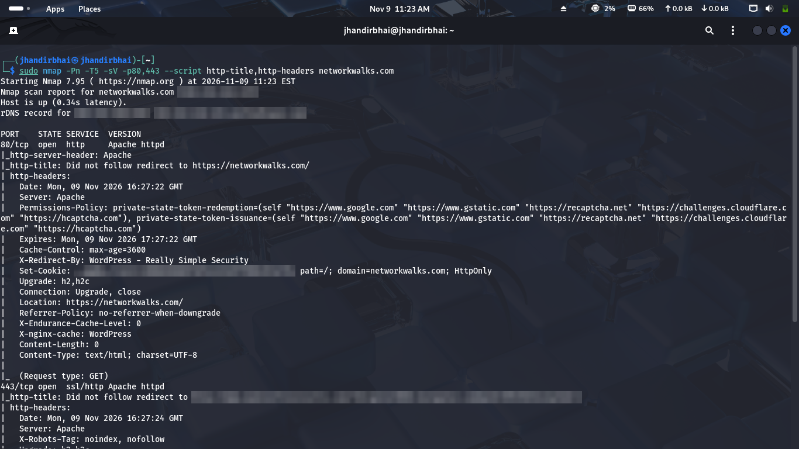
*Figure 12: Nmap http-title and http-headers on ports 80 and 443 (1 of 2)*

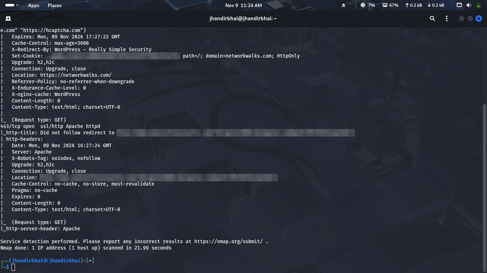
*Figure 13: Nmap http-title and http-headers on ports 80 and 443 (2 of 2)*

#### SMTP (26, 465, 587): `smtp-commands`
Exim smtpd 4.100.1 identified on ports 26 and 587. The script could not establish a connection, so no command list was collected.

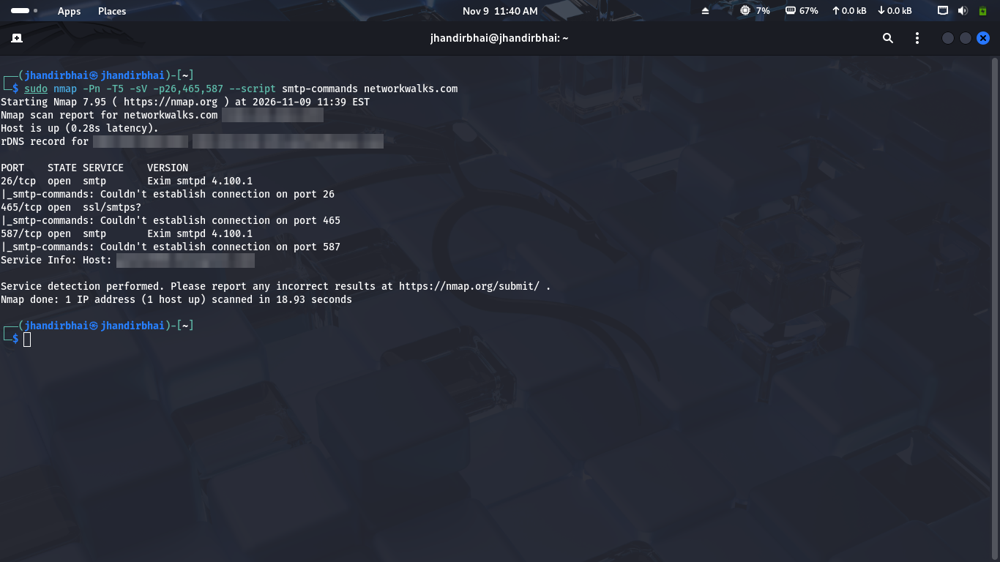
*Figure 14: Nmap smtp-commands scan on ports 26, 465 and 587*

#### MySQL (3306): `mysql-info`
Returned protocol 10, version **5.7.44-48**, capability flags and the authentication plugin **`mysql_native_password`**.

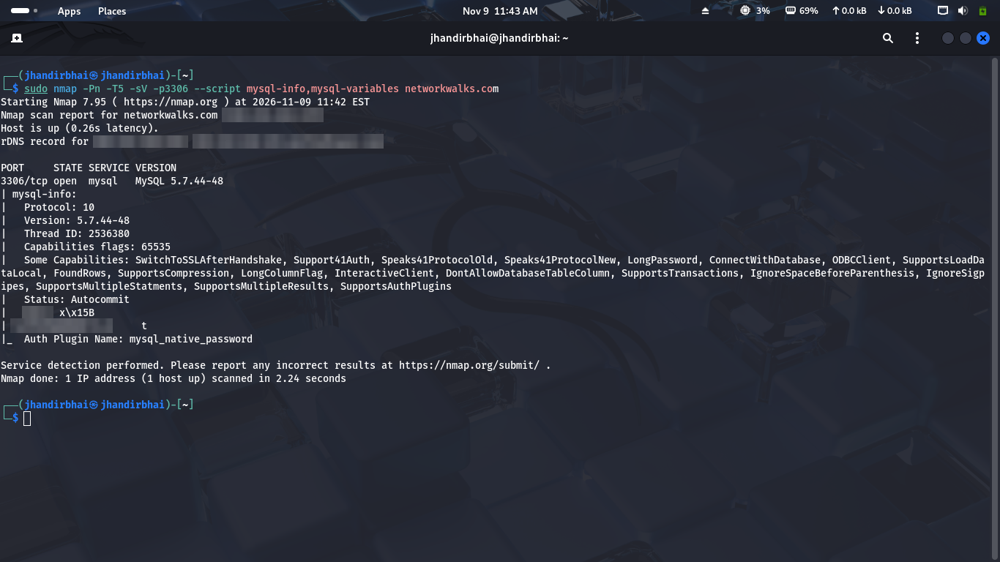
*Figure 15: Nmap mysql-info scan on port 3306*

#### SSH (22, 2222): `ssh2-enum-algos`
**OpenSSH 9.9** on both ports, offering 14 key exchange algorithms (including `sntrup761x25519` and `mlkem768x25519`), 4 host key algorithms, 6 ciphers and 10 MAC algorithms, among them `hmac-sha1` variants.

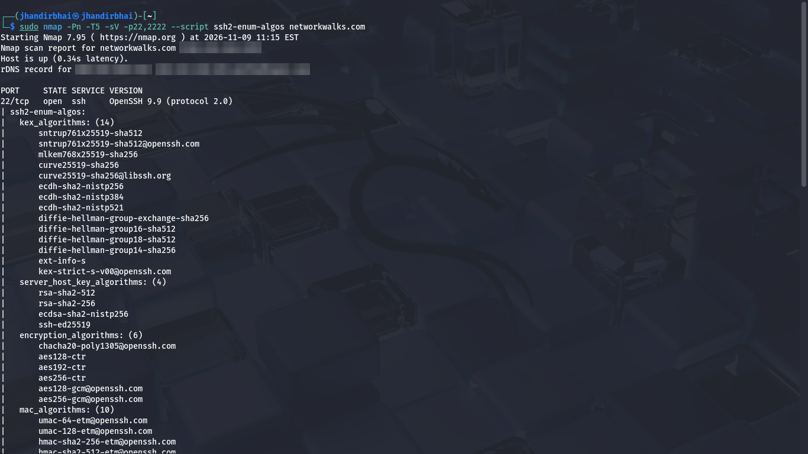
*Figure 16: Nmap ssh2-enum-algos on ports 22 and 2222 (1 of 3)*

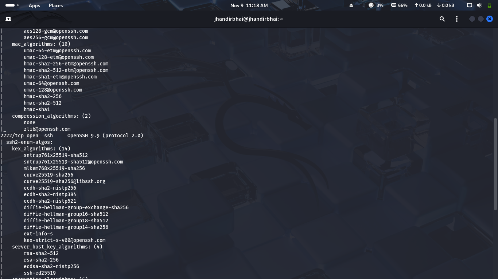
*Figure 17: Nmap ssh2-enum-algos on ports 22 and 2222 (2 of 3)*

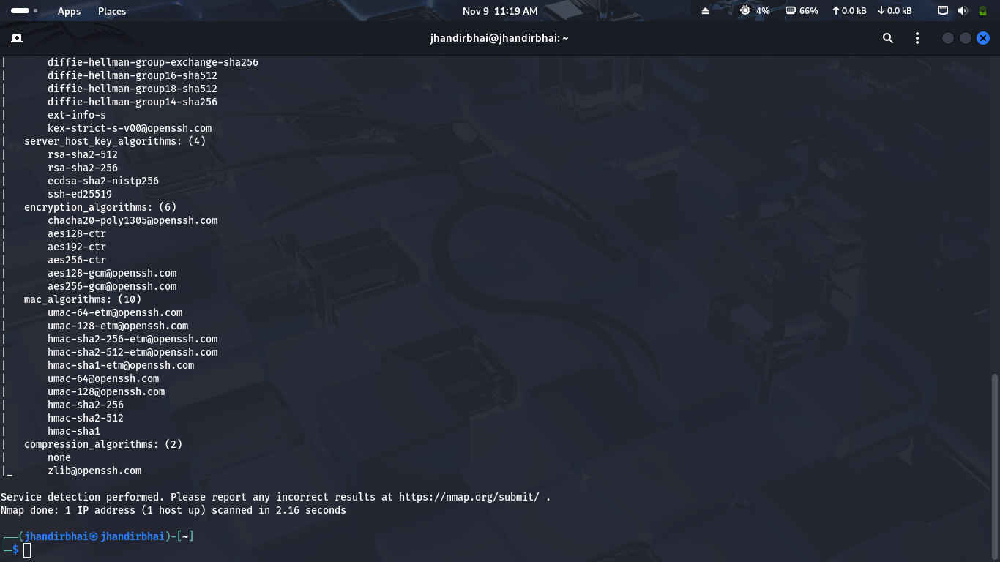
*Figure 18: Nmap ssh2-enum-algos on ports 22 and 2222 (3 of 3)*

#### TLS (443, 465, 993, 995): `ssl-cert`, `ssl-enum-ciphers`
- Web certificate: CN `networkwalks.com` (wildcard SAN), issued by **Let's Encrypt**, RSA 2048, valid **2026-10-23 to 2027-01-21**.
- Only TLS 1.2 and 1.3 ciphers listed, all graded **A**.
- Dovecot ports 993/995 use a **separate wildcard certificate that expired 2025-12-21**; its SANs also include `aurumme.com` domains.

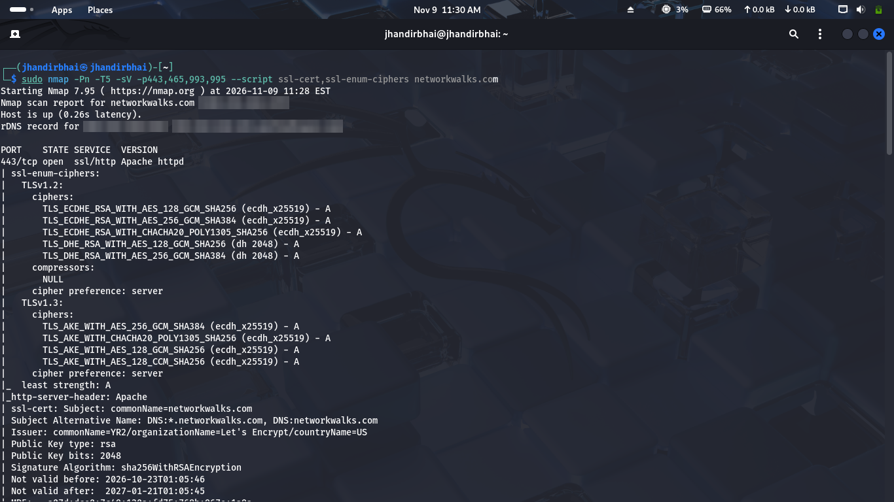
*Figure 19: Nmap ssl-cert and ssl-enum-ciphers on port 443 (1 of 5)*

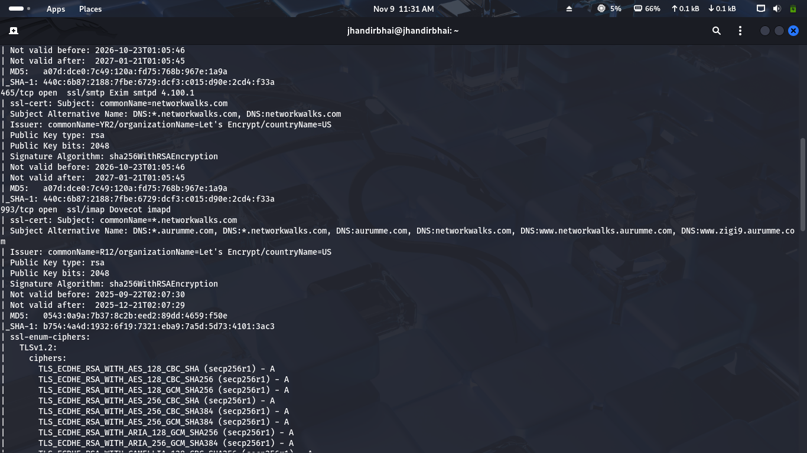
*Figure 20: Nmap ssl-cert and ssl-enum-ciphers, certificates on 443/465/993 (2 of 5)*

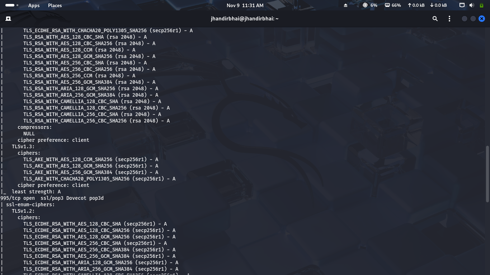
*Figure 21: Nmap ssl-enum-ciphers, ports 993 and 995 (3 of 5)*

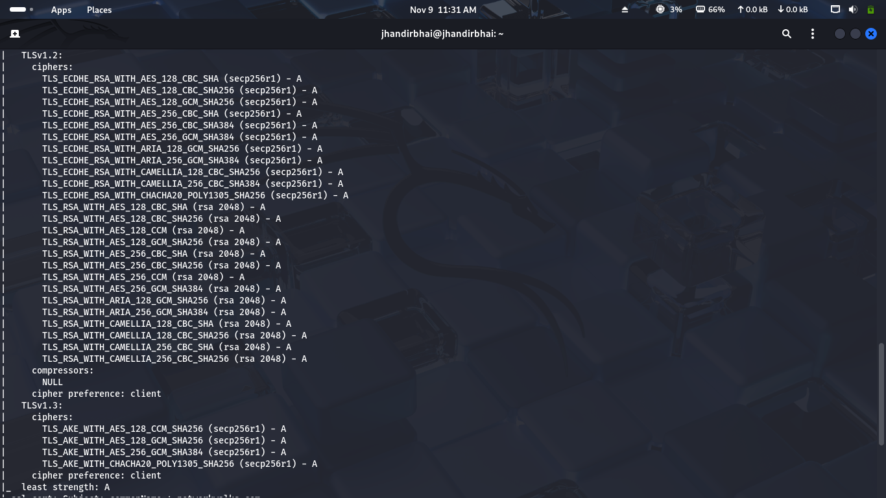
*Figure 22: Nmap ssl-enum-ciphers, port 995 (4 of 5)*

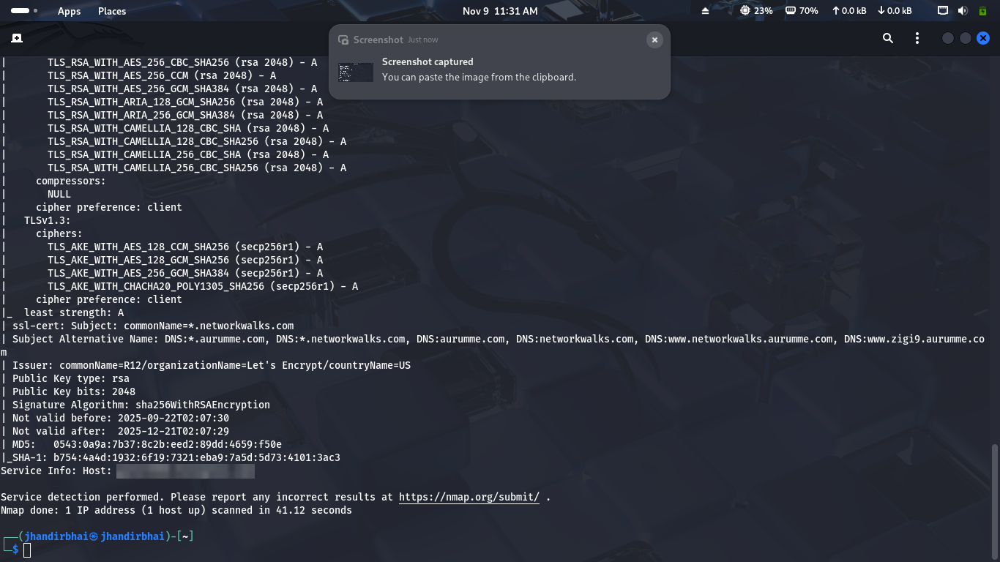
*Figure 23: Nmap ssl-cert for port 995 and scan summary (5 of 5)*

> **Note:** The first scan and targeted scans used the aggressive `-T5` timing template, which can miss ports on slower links. Port 465 was absent from the first scan but open in later ones, so the port list should be treated as a **minimum**.

---

## 📊 Findings Summary

| Severity | Count | Findings |
| --- | :---: | --- |
| 🔴 Critical | 0 | None |
| 🟠 Medium | 5 | #1 Web tech exposed, #2 MySQL reachable, #3 Plaintext-capable services, #4 Expired TLS certificate, #5 DNS info / no DNSSEC |
| 🟢 Low | 6 | #6 Service versions, #7 Server IP, #8 HTTP header info, #9 WAF identifiable, #10 SSH on two ports, #11 Shared certificate |

## 🧮 Risk Analysis / Impact

| # | Risk / Finding | Evidence / Observation | Potential Impact | Level |
| --- | --- | --- | --- | :---: |
| 1 | Web technology information exposed | WhatWeb identified WordPress 7.1.4, WP Download Manager 3.3.76, Apache and jQuery 3.7.1 | Attackers may use exposed technology/version information to identify software requiring further security review | 🟠 Medium |
| 2 | MySQL database port reachable from the internet | Nmap found 3306/tcp open running MySQL 5.7.44-48 and returned handshake and capability details | A public database service increases the attack surface; MySQL 5.7 is also past its end-of-life date | 🟠 Medium |
| 3 | Plaintext-capable services exposed | FTP (21), POP3 (110) and IMAP (143) are open | Credentials and data may travel unencrypted if TLS is not enforced on these services | 🟠 Medium |
| 4 | Expired TLS certificate on mail ports | ssl-cert on 993/995 showed validity ending 2025-12-21, while the scan was run on 2026-11-09 | Users may be trained to accept certificate warnings, which weakens trust in the mail service | 🟠 Medium |
| 5 | DNS infrastructure information exposed | DNSRecon found SOA/NS, MX, SPF TXT, 8 autodiscover SRV records and BIND 9.16.23-RH; DNSSEC is not configured | DNS information can help build a broader infrastructure profile; no DNSSEC means answers are not cryptographically signed | 🟠 Medium |
| 6 | Service versions disclosed | Banners showed OpenSSH 9.9, Exim 4.100.1, Dovecot, Apache and BIND | Helps attackers map the server and look for version-specific weaknesses | 🟢 Low |
| 7 | Server IP address identifiable | Nslookup resolved the domain to an IP address (redacted in the evidence) | Provides information about the network location of the web service | 🟢 Low |
| 8 | HTTP technical information exposed | Curl showed /wp-json/ in the Link header; no HSTS, CSP or X-Frame-Options header was returned | May assist technology fingerprinting and further enumeration; browser-side protections are missing | 🟢 Low |
| 9 | WAF technology identifiable | Wafw00f identified ModSecurity (SpiderLabs) | Reveals information about the web application's security architecture | 🟢 Low |
| 10 | SSH on two ports with legacy options | OpenSSH 9.9 on 22 and 2222; hmac-sha1 MACs still offered | Extra SSH entry points and older algorithms slightly widen the attack surface | 🟢 Low |
| 11 | Shared certificate reveals other domains | The 993/995 certificate lists aurumme.com and www.zigi9.aurumme.com as alternative names | Shows that other domains share the same mail host | 🟢 Low |

**Risk level key:** 🔴 Critical &nbsp;·&nbsp; 🟠 Medium &nbsp;·&nbsp; 🟢 Low

> The risks above are observations from the footprinting and scanning exercises, **not confirmed vulnerabilities**. No exploitation or vulnerability validation was performed. The presence of a software version, an open port or a DNS record does not by itself mean the system is vulnerable.

---

## ✅ Recommendations

| Priority | # | Recommendation | Details |
| :---: | :---: | --- | --- |
| 🟠 | 1 | **Restrict database exposure** | Make MySQL (3306) reachable only from localhost or trusted IPs. Plan an upgrade from MySQL 5.7 (no longer supported). |
| 🟠 | 2 | **Close or replace unnecessary services** | Replace FTP with SFTP/FTPS; close unneeded ports (extra SSH port, non-standard mail port) or restrict them with firewall rules. |
| 🟠 | 3 | **Enforce encryption for mail services** | Require TLS for POP3/IMAP, or disable ports 110 and 143 if not needed. |
| 🟠 | 4 | **Renew certificates and monitor expiry** | Replace the expired IMAPS/POP3S certificate and set up expiry monitoring. |
| 🟢 | 5 | **Review exposed technology information** | Regularly review what CMS, plugin and web technology details are publicly visible. |
| 🟠 | 6 | **Keep software updated** | Update WordPress, WP Download Manager, BIND, Exim, OpenSSH, Dovecot and Apache; review against current advisories. |
| 🟢 | 7 | **Review HTTP headers** | Add HSTS, X-Frame-Options, Content-Security-Policy and X-Content-Type-Options; remove unnecessary technical headers. |
| 🟢 | 8 | **Review DNS records regularly** | Consider DNSSEC, hide the BIND version, and review the SPF record (currently ending `~all`). |
| 🟢 | 9 | **Harden SSH** | Use key-based authentication, restrict by IP, disable older algorithms such as `hmac-sha1` where clients allow. |
| 🟢 | 10 | **Configure and monitor the WAF** | Keep ModSecurity enabled and tuned. |
| 🟢 | 11 | **Test only with authorization** | Reconnaissance and scanning must only be performed where appropriate authorization exists. |

---

## ⚠️ Limitations

- Findings are based on **information gathering and port/service identification only**. Nothing was exploited or validated.
- Scans used the aggressive **`-T5`** timing template, so the open-port list is a **minimum**.
- The **OS detection** result was unreliable (virtualised/NAT path), so the OS was taken from the service scan instead.
- The `smtp-commands` NSE script could not connect, so no SMTP command list was collected.
- Phases 3-5 are still in progress.

---

## 🧠 Conclusion & Lessons Learned

- Even before exploitation, careful analysis of public information and network responses reveals a great deal about an environment.
- Each tool answers a different question: WHOIS (registration), WhatWeb (technologies), Nslookup (resolution), Curl (headers), Wafw00f (WAF), DNSRecon (DNS), Nmap (ports, services, TLS).
- A good report explains what was done, what was found, what it means, what risk it creates and how to reduce it.
- Reconnaissance and scanning must **always** stay within an authorized scope.

---

## 🖼 Evidence Index

All 25 screenshots live in [`evidence/`](evidence/).

| Fig. | Description | Phase |
| :---: | --- | --- |
| 1 | WHOIS (registry record) | Footprinting |
| 2 | WHOIS (registrar record), contacts via privacy proxy | Footprinting |
| 3 | WHOIS name servers and DNSSEC status | Footprinting |
| 4 | WhatWeb fingerprint | Footprinting |
| 5 | Nslookup (IP redacted) | Footprinting |
| 6 | Curl -I HTTP headers | Footprinting |
| 7 | Wafw00f: ModSecurity (SpiderLabs) | Footprinting |
| 8 | DNSRecon enumeration | Footprinting |
| 9 | Local IP and route | Scanning |
| 10 | Nmap -T5 -Pn open ports | Scanning |
| 11 | Nmap dns-nsid (port 53) | Scanning |
| 12-13 | Nmap http-title / http-headers (80, 443) | Scanning |
| 14 | Nmap smtp-commands (26, 465, 587) | Scanning |
| 15 | Nmap mysql-info (3306) | Scanning |
| 16-18 | Nmap ssh2-enum-algos (22, 2222) | Scanning |
| 19-23 | Nmap ssl-cert / ssl-enum-ciphers (443, 465, 993, 995) | Scanning |
| 24 | Nmap -sS -sV service version scan | Scanning |
| 25 | Nmap -O OS detection | Scanning |

---

## 📁 Repository Structure

```text
.
├── README.md                                   # Full project write-up (this file)
├── Pentest_Report_Networkwalks_Updated.docx    # Formatted full report
└── evidence/                                   # 25 screenshots
    ├── Figure_01_WHOIS_registry.png
    ├── ...
    └── Figure_25_Nmap_OS_detection.png
```

---

## ⚖️ Legal Disclaimer

I have performed these activities only on the systems & devices where I had secured written permission or the devices/systems that I own myself. All these materials are for **education and research purpose only**. Do not use anything from here to break the law. The instructor, the authors and Networkwalks are not responsible for what you do with this knowledge. Every action you take is your own responsibility. Misuse can lead to criminal charges, heavy fines, loss of your job and a permanent record. In most countries unauthorised access is a crime even when nothing is damaged.

---

## 👤 Author

**Muhammad Anas Ishfaq**, Cybersecurity Professional
Cybersecurity Program at Networkwalks &nbsp;|&nbsp; 9 November 2026

🔗 LinkedIn: _add your profile link_ &nbsp;|&nbsp; 📧 _add your contact email_

> **Next:** Phases 3-5 are in progress. ⭐ Star the repo to follow along.

<div align="center">

**Topics for the GitHub repo settings:**
`penetration-testing` · `ethical-hacking` · `cybersecurity` · `nmap` · `kali-linux` · `footprinting` · `reconnaissance` · `network-scanning` · `pentest-report` · `infosec` · `vulnerability-assessment` · `dns-enumeration` · `osint` · `tls` · `whois` · `wafw00f` · `dnsrecon` · `whatweb` · `networkwalks` · `red-team`

</div>
